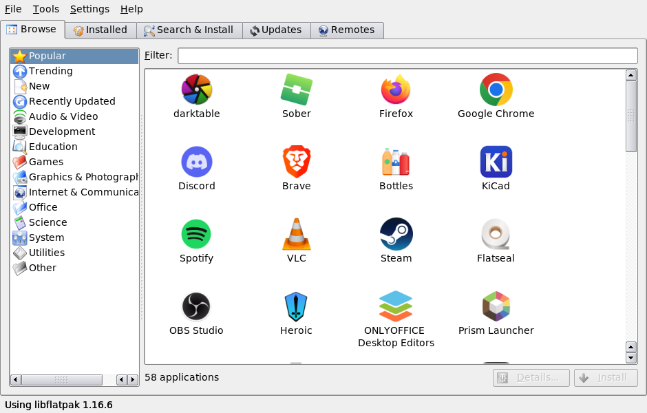
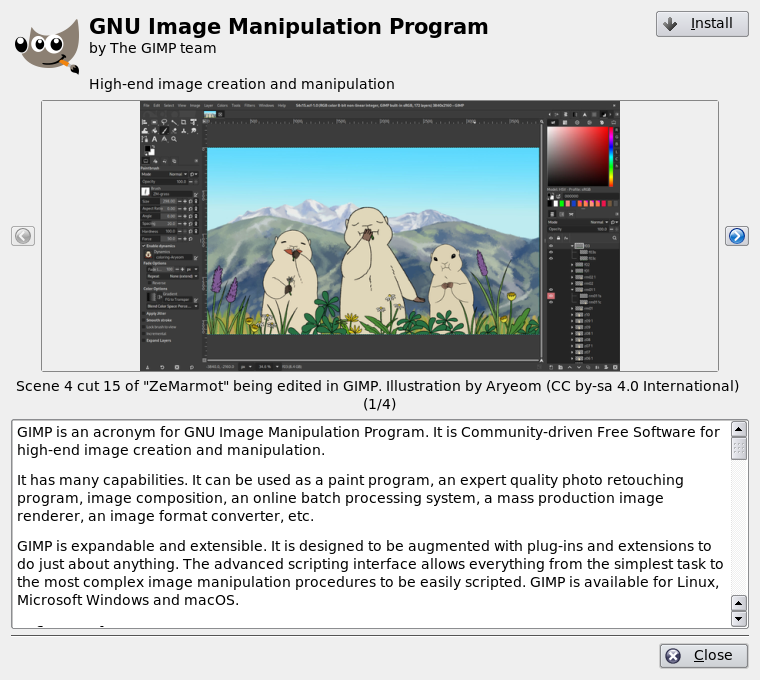
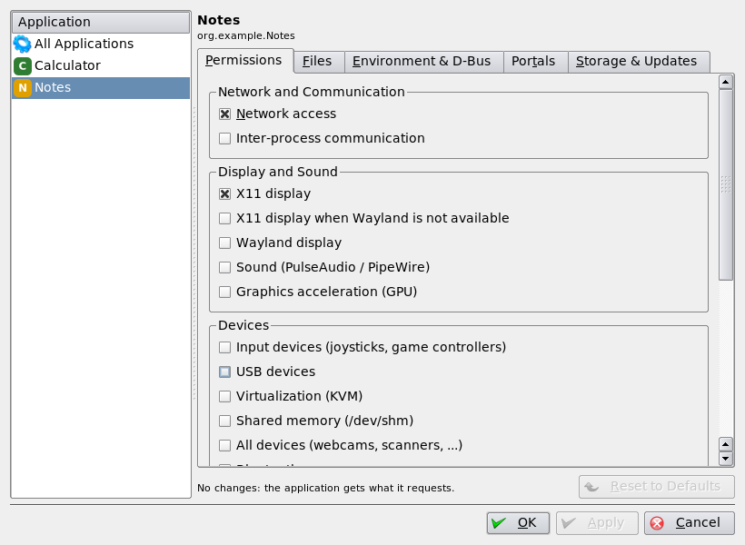
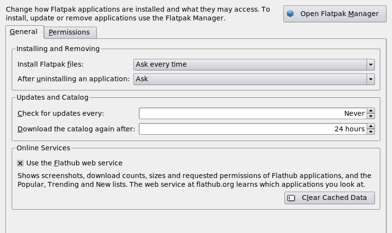
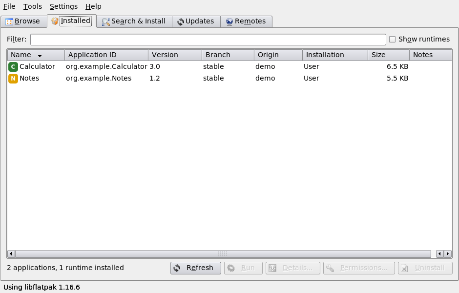
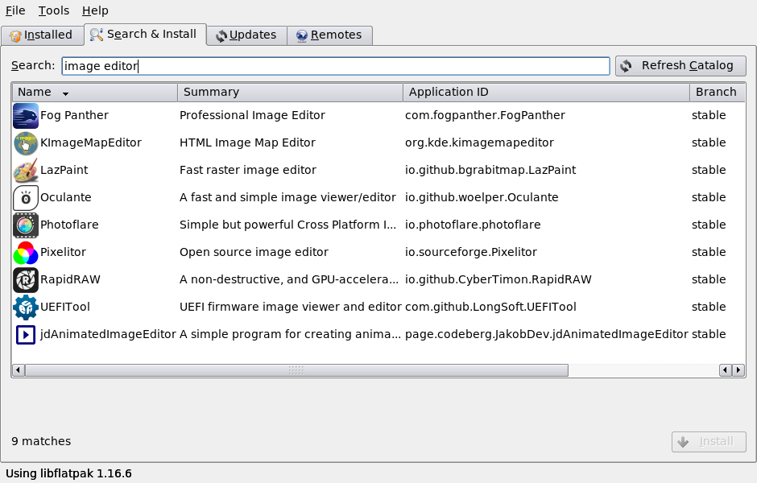
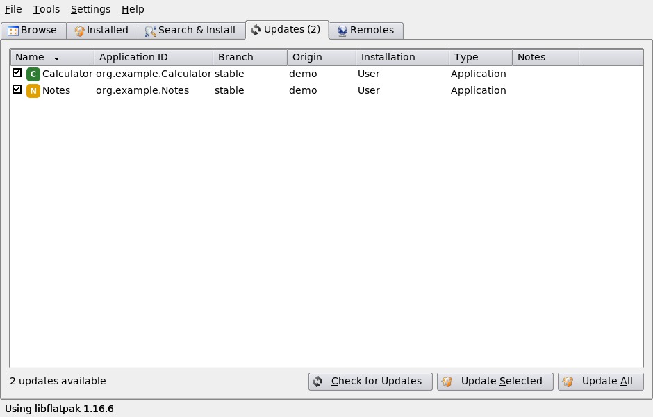
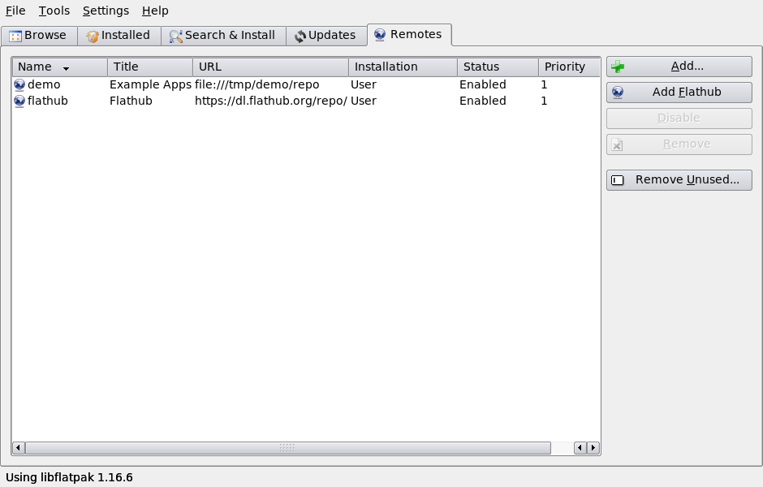
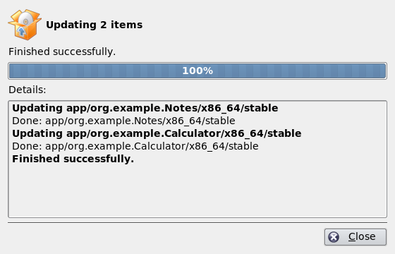
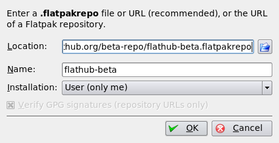

# tdeflatpak: Flatpak Manager for the Trinity Desktop Environment

> [!WARNING]
> **Disclaimer: this project was vibe coded.**
> This application was written largely with the help of an AI coding
> assistant. It has **not been thoroughly reviewed or tested**, may contain
> bugs, and **can modify the Flatpak installations on your system** (install,
> update and uninstall software, add and remove remotes). It is provided
> **as-is, without any warranty**. Use it at your own risk and keep backups.

`tdeflatpak` is a native [Trinity Desktop Environment](https://trinitydesktop.org)
(TDE) application for managing [Flatpak](https://flatpak.org). It is written in
C++ with TQt3/tdelibs and talks to Flatpak through the **libflatpak API**,
not the `flatpak` command line tool. Its design takes ideas from GNOME
Software's flatpak plugin and Plasma Discover's Flatpak backend.

## Features

- **Browse**: an app store view. The categories (Audio & Video, Games,
  Graphics, ...) come from the AppStream data of every enabled remote, so they
  work offline and for any repository. For Flathub, the *Popular*,
  *Trending*, *New* and *Recently Updated* lists of the Flathub web API are shown too.
- **Application details**: description, screenshots, release notes, license,
  links, download and installed size, Flathub install count, and the
  permissions the application requests, with risky ones highlighted. The
  details come from the local AppStream data and, for Flathub apps, from the
  [Flathub v2 API](https://flathub.org/api/v2) (`/appstream`, `/summary`, `/stats`).
- **Permissions** (similar to Flatseal): per-user overrides of what an
  application may access, such as network, display, sound, devices, files
  and folders, environment variables and D-Bus names. There is a global
  entry for all applications. Changes are written to
  `~/.local/share/flatpak/overrides`, the same as `flatpak override --user`.
  The editor also shows and revokes **portal permissions** (notifications,
  camera, background, ...), shows and deletes an application's **data**
  (`~/.var/app/<id>`), and can **block updates** of an application
  (`flatpak mask`).
- **Control Center module**: *Flatpak Applications* in the Trinity Control
  Center (`tdecmshell tdeflatpak-settings`). It holds the preferences and the
  permission editor.
- **Preferences**: default installation for `.flatpakref` files, periodic
  update checks, catalog age, whether to use the Flathub web service, and
  whether to delete application data on uninstall.
- **Installed**: lists installed applications and runtimes in both the user
  and the system installation, with filtering. You can run applications,
  show their details, edit their permissions, uninstall them, block updates
  of applications and pin runtimes.
- **Search & Install**: searches the AppStream catalogs of all enabled remotes
  by name, ID or summary, showing icons, and installs applications.
- **Updates**: checks for updates and updates the selected items or all of them.
- **Remotes**: lists, adds (from a `.flatpakrepo` file or URL, or with a
  one-click *Add Flathub*), enables and disables, and removes remotes.
  *Remove Unused* cleans up runtimes that are no longer needed.
- Opens `.flatpakref` files (to install) and `.flatpakrepo` files (to add a
  remote) from the file manager or the command line.
- Shows live progress and a detailed log for each operation, with Cancel support.

## Screenshots

| Browse | Application details |
| --- | --- |
|  |  |
| **Permissions** | **Control Center module** |
|  |  |
| **Installed** | **Search & Install** |
|  |  |
| **Updates** | **Remotes** |
|  |  |
| **Progress dialog** | **Add Remote dialog** |
|  |  |

The screenshots come from `scripts/take-screenshots.sh`, which runs the app
under Xvfb with a demo repository and the real Flathub catalog. The same
images are used in the handbook.

## Documentation

- **Handbook**: open it with *Help → Flatpak Manager Handbook*, or in
  KHelpCenter at `help:/tdeflatpak`. The source is `doc/en/index.docbook`.
- **Man page**: run `man tdeflatpak`; it is installed to
  `/opt/trinity/share/man/man1`. The source is `doc/man/tdeflatpak.1`.

## Installing

Download the `.deb` from the
[GitHub Actions artifacts](../../actions/workflows/build-deb.yml) or a
[release](../../releases), then:

```sh
sudo apt install ./tde-flatpak-trinity_*_amd64.deb
```

The package depends on `flatpak` and recommends:

- `polkit-agent-tde`: a polkit authentication agent. It is required for
  system-wide operations, because libflatpak asks for authorization through
  polkit.
- `xdg-desktop-portal-trinity`: the TDE backend for the XDG desktop portals,
  which Flatpak applications use for file dialogs, opening URLs and similar.

Start it from the TDE menu (*System → Flatpak Manager*) or run
`tdeflatpak [file.flatpakref|file.flatpakrepo] [--browse|--updates|--search|--remotes]`.
`tdeflatpak --details <app-id>` and `tdeflatpak --permissions <app-id>` open
the details or the permission editor of one application. The settings are
also in the Trinity Control Center under *Flatpak Applications*.

### Privacy

When *Use the Flathub web service* is enabled (the default), tdeflatpak asks
`flathub.org` for details, statistics and the featured lists of Flathub
applications, so Flathub learns which applications you look at. Responses are
cached in `~/.cache` (TDE cache directory, `tdeflatpak/`). Turn it off in
*Settings → Configure Flatpak Manager*; everything else keeps working with
the local AppStream data.

## Building

The package is built in a Debian Docker container with TDE R14.1.x from the
official Trinity repository. Trixie is the default; set `SUITE=bookworm` for
Debian 12, whose package version gets a `~bookworm` suffix:

```sh
scripts/build-deb.sh          # writes dist/tde-flatpak-trinity_*.deb (runs lintian)
SUITE=bookworm scripts/build-deb.sh   # the same for Debian 12 bookworm
scripts/compile-check.sh      # quick compile-only check
scripts/take-screenshots.sh   # regenerate screenshots/ (needs the built .deb)
```

Building manually on a Debian/TDE system with the build dependencies from
`debian/control` installed:

```sh
cmake -B build -DCMAKE_INSTALL_PREFIX=/opt/trinity
cmake --build build
```

## Tests

Unit tests (Flathub JSON parsing against saved responses in `tests/fixtures`,
AppStream parsing, override files, mask patterns):

```sh
cmake -B build -DBUILD_TESTS=ON && cmake --build build && build/tests/tdeflatpak-unittests
```

The GUI tests run inside the build image under Xvfb and drive the GUI with `xdotool`:

```sh
# install from a .flatpakref and uninstall via the GUI, using a tiny local
# signed test repository (no large downloads)
docker run --rm -v "$PWD":/src:ro -v /tmp/shots:/shots tdeflatpak-build:trixie \
    bash /src/tests/transaction-test.sh /shots

# details, Browse, permission overrides, portal permissions, blocking
# updates, deleting app data and the Control Center module, checked with the
# flatpak command line tool (local test repository, no network)
docker run --rm -v "$PWD":/src:ro -v /tmp/shots:/shots tdeflatpak-build:trixie \
    bash /src/tests/features-test.sh /shots

# start-up smoke test of every page; --with-flathub also loads the real
# Flathub catalog, searches it and opens the details of GIMP
docker run --rm -v "$PWD":/src:ro -v /tmp/shots:/shots tdeflatpak-build:trixie \
    bash /src/tests/smoke-test.sh [--with-flathub] /shots
```

The GitHub Action (`.github/workflows/build-deb.yml`) builds the package, runs
the tests and uploads the `.deb` and the screenshots as artifacts. Pushing a
`v*` tag also attaches the `.deb` to a GitHub release.

## Architecture

| File | Purpose |
| --- | --- |
| `src/flatpakbackend.*` | Synchronous libflatpak queries: installed refs, remotes, launch |
| `src/flatpakjob.*` | `TQThread` worker with its own `GMainContext`. Runs `FlatpakTransaction`s, AppStream refreshes, update checks and remote changes, and posts progress events to the GUI |
| `src/appstream.*` | Streaming parser for AppStream XML (gzip): the catalog (name, summary, icon, bundle, categories) and the full details of one component |
| `src/catalog.*` | The catalog shared by the Browse and Search pages |
| `src/flathubapi.*`, `src/flathubjson.*` | Asynchronous Flathub web API client (TDEIO, disk cache) and its json-glib parsers |
| `src/overrides.*` | Reads app metadata and reads and writes user override files |
| `src/portalpermissions.*` | xdg-desktop-portal permission store over GDBus |
| `src/permissionswidget.*`, `src/preferenceswidget.*` | Permission editor and preferences, shared by the app and the Control Center module |
| `src/appdetailsdialog.*` | Application details |
| `src/appactions.*` | Install, uninstall, launch, mask/pin and delete-data flows |
| `src/settings.kcfg` | Settings (KConfigXT, `tdeflatpakrc`) |
| `src/kcm/` | The Control Center module |
| `src/operationdialog.*` | Progress and log dialog for a job |
| `src/*page.*` | The tabs |
| `src/flatpak_p.h` | The only place `<flatpak.h>` is included; it works around the GLib/TQt `signals` macro clash |

## License

GPL-2.0-or-later
